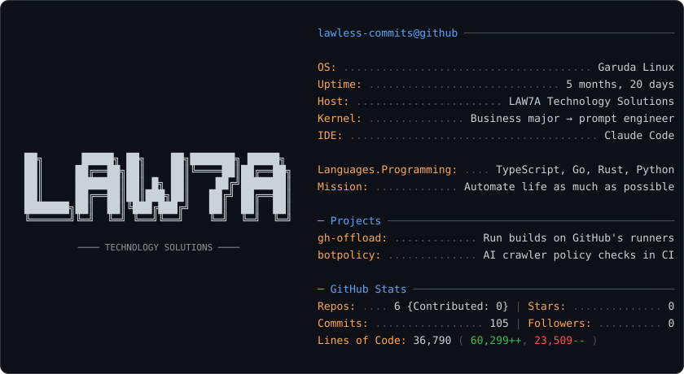

<picture>
  <source media="(prefers-color-scheme: dark)" srcset="dark_mode.svg">
  <source media="(prefers-color-scheme: light)" srcset="light_mode.svg">
  
</picture>

### Hi, I'm LAW7A

A business major turned prompt engineer who wants to innovate and automate life as much as possible. I build small developer tools that take the busywork out of shipping software.

#### Projects

**[gh-offload](https://github.com/lawless-commits/gh-offload)**: run your uncommitted code on GitHub's Linux, ARM, macOS and Windows runners, straight from your terminal. I built it because my 8 GB laptop couldn't finish a release build of my own project (please send ram).

[](https://github.com/lawless-commits/gh-offload)

```sh
gh extension install lawless-commits/gh-offload
```

**[botpolicy](https://github.com/lawless-commits/botpolicy)**: check what each AI crawler can actually reach on your site, and fail CI when that drifts from your written policy. ([demo](https://github.com/lawless-commits/botpolicy-demo))
